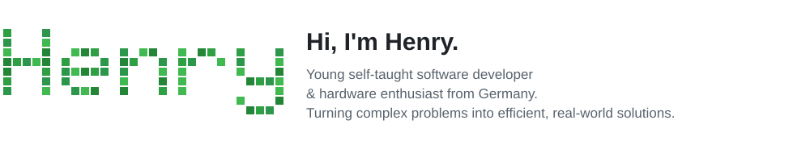

## About

I’m a self-taught developer and hardware hobbyist from Germany who enjoys projects that fall somewhere between code and circuit boards—such as “Akku-Craft,” a modular power bank platform that I’m developing from scratch, or the Minecraft modding tools I distribute through HMLabs Gaming. I learn best by building things I really want and then figuring out the rest as I go.

## Stats

  
  

## Projects

- **HMLabs Gaming** – Minecraft mods, plugins, modpacks and resource packs. · [Details](https://henrymeyer.de/projects/hmlabs-gaming/) · [Website](https://gaming.hmlabs.eu/)
- **Akku-Craft** – Modular power-bank platform focused on hardware reliability and expandability. · [Details](https://henrymeyer.de/projects/akku-craft/) · [Website](https://akku-craft.eu/)
- **Projekt Ansichtssache** – Tools for digital accessibility and a more inclusive web. · [Details](https://henrymeyer.de/projects/projekt-ansichtssache/) · [GitHub](https://github.com/Projekt-Ansichtssache)
- **HMLabs** – Open-source projects across software, tools and Minecraft. · [Details](https://henrymeyer.de/projects/hmlabs/) · [Website](https://hmlabs.eu/)

[All projects](https://henrymeyer.de/projects/)

---

<a href="https://henrymeyer.de/code-of-conduct">Code of Conduct</a>
